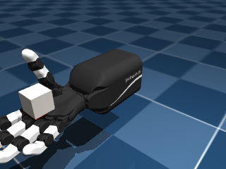
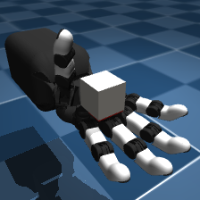
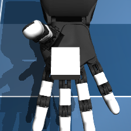
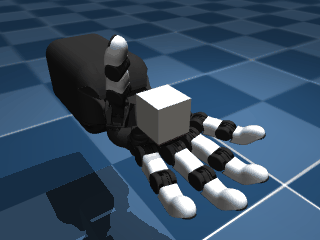

# Pi0-ORCA-Integration

Closed-loop Vision-Language-Action ($\pi_0$) and hierarchical Reinforcement Learning (PPO) control for the 17-DoF ETH ORCA dexterous robotic hand in MuJoCo.

Developed as part of the **SEP 730 — Dexterous Hand Technical Challenge & Future Application** research project at McMaster University.

---

## Overview

Pretrained Vision-Language-Action (VLA) foundation models such as Physical Intelligence's $\pi_0$ (`pi0_libero`, `pi0_droid`, `pi0_base`) output low-dimensional action chunks tailored to standard 7-DoF robotic arms with 1-DoF parallel-jaw grippers. Directly applying these predictions to a high-degree-of-freedom, tendon-driven anthropomorphic hand (the 17-DoF ETH ORCA hand) introduces two primary control bottlenecks:

1. **Embodiment and Action-Space Mismatch:** Mapping a 1D gripper command or raw 7D Cartesian delta directly to 17 coupled finger and thumb actuators produces uncoordinated joint excursions, finger chattering, and immediate object ejection.
2. **Contact-Rich In-Hand Manipulation Dynamics:** Tasks such as in-hand cube reorientation require continuous multi-finger gaiting and velocity damping at 20 Hz, whereas 3B-parameter VLA inference operates at approximately 3.5–3.7 Hz on consumer GPU hardware.

This repository implements the observation pipeline, 17-DoF in-hand synergy adapters, relative joint-target wrappers, and hierarchical $\pi_0$ + PPO control architecture required to run $\pi_0$ in closed loop on the **17-DoF In-Hand Cube Reorientation (`OrcaHandRightCubeOrientation` / `scene_right_cube_orientation.xml`)** benchmark environment:

* **Task Objective:** Using only the 17-DoF ORCA right hand, manipulate a cube inside the palm from a non-solved initial orientation (`down` at $180^\circ$ or `random` across $90^\circ / 180^\circ$ orientations) to align its red face within $15^\circ$ of world-up and hold it stationary ($\|\omega\| \le 1.0\text{ rad/s}$, $\|v\| \le 0.1\text{ m/s}$) for 25 consecutive control steps ($1.25\text{ s}$ at $20\text{ Hz}$) without dropping it.

| Default Scene View (`default_free`) | Oblique Palmar View (`palm_front`) | Overhead Palmar View (`palm_top`) |
| :---: | :---: | :---: |
|  |  |  |

### In-Hand Cube Reorientation Rollout Demonstration (10M-Step SAC Policy)


---

## Repository Structure

```text
Pi0-ORCA-Integration/
├── orca_vla/
│   ├── __init__.py                 # Package exports
│   ├── cameras.py                  # Offscreen MuJoCo RGB camera renderer and virtual palmar viewpoints
│   ├── observations.py             # Multi-camera + proprioceptive observation builders for pi0
│   ├── actions.py                  # 17-DoF ORCA hand action-space and in-hand synergy adapters
│   └── reorient_expert_trajs.npz   # Reference relative-joint trajectories across canonical cube orientations
├── scripts/
│   ├── check_gpu_environment.py    # Hardware, VRAM, and headless EGL rendering verification
│   ├── run_cube_reorient.py        # Closed-loop runner for 17-DoF in-hand cube reorientation
│   ├── benchmark_cube_reorient.py  # 5-level evaluation suite for 17-DoF in-hand reorientation
│   ├── train_rl_reorient.py        # Matched multi-core RL trainer (PPO, SAC, TD3)
│   ├── evaluate_rl_reorient.py     # Comparative evaluation script for trained RL policies
│   └── slurm_drac_rl_benchmark.sh  # Slurm job array for 10M-step training on DRAC Nibi CPU cluster
├── models/
│   └── ppo_cube_reorient.zip       # Pretrained Stable-Baselines3 PPO policy for 17-DoF cube reorientation
├── results/
│   └── cube_reorient_metrics.csv   # Quantitative evaluation metrics across all 5 benchmark levels
├── tests/
│   ├── test_action_adapter.py      # Unit tests for 17-DoF ORCA hand bounds and in-hand synergy deltas
│   ├── test_observations.py        # Unit tests for offscreen rendering and pi0 observation formatting
│   └── test_hybrid_reorient.py     # Closed-loop integration test for 17-DoF cube reorientation and 25-step hold
├── docs/
│   ├── ARCHITECTURE.md             # Technical specification of the observation, action, and hybrid RL layers
│   ├── BENCHMARKS.md               # Full experimental protocol, hardware profile, and failure analysis
│   └── DRAC_CLUSTER_GUIDE.md       # Instructions for 10M-step RL training on the DRAC Nibi cluster
└── pyproject.toml
```

---

## System Requirements and Hardware Profile

All experiments in this repository were developed and verified on an 8 GB consumer laptop GPU running under Ubuntu 22.04 (WSL2):

* **GPU:** NVIDIA GeForce RTX 4070 Laptop GPU (`8,188 MiB` GDDR6 VRAM)
* **Precision & XLA Configuration:** `bfloat16` via JAX XLA JIT with on-demand platform memory allocation (`XLA_PYTHON_CLIENT_PREALLOCATE=false`, `XLA_PYTHON_CLIENT_ALLOCATOR=platform`)
* **Active VRAM Footprint:** `6,317 MiB` after loading the 3B-parameter $\pi_0$ checkpoint; `6,341 MiB` (`80.4%` of total VRAM including driver overhead) during active closed-loop inference alongside MuJoCo `224x224` offscreen EGL rendering
* **Inference Latency:** `~287–303 ms` per 50-step flow-matching action chunk (`~3.3–3.5 Hz`), after a one-time XLA JIT compilation warmup of `~32.8 s` on step 0

---

## Installation and Setup

### 1. Clone the Simulation Environment and OpenPI Runtime

This package expects the shared MuJoCo simulation repository ([SEP730-Dexterous-Hand-Simulation](https://github.com/joewukingdom/SEP730-Dexterous-Hand-Simulation)) and the [openpi](https://github.com/Physical-Intelligence/openpi) environment:

```bash
git clone https://github.com/joewukingdom/SEP730-Dexterous-Hand-Simulation.git ~/SEP730-Dexterous-Hand-Simulation
git clone https://github.com/gulserenfedakar/Pi0-ORCA-Integration.git ~/Pi0-ORCA-Integration
cd ~/Pi0-ORCA-Integration
```

If `SEP730-Dexterous-Hand-Simulation` is located in a non-default directory, export `ORCA_SIM_ROOT`:

```bash
export ORCA_SIM_ROOT=/path/to/SEP730-Dexterous-Hand-Simulation
```

### 2. Install Package and Dependencies

Inside your `openpi` virtual environment (Python 3.11+ with JAX CUDA and MuJoCo 3.2+):

```bash
uv pip install --no-deps stable-baselines3
uv pip install -e .
```

### 3. Verify GPU and Offscreen Rendering

```bash
python scripts/check_gpu_environment.py
```

### 4. Run the Automated Test Suite

```bash
pytest -v
```

---

## Running Closed-Loop Control and Benchmarks

Run a single closed-loop episode on `OrcaHandRightCubeOrientation` (`scene_right_cube_orientation.xml`):

```bash
# Level 3: Hybrid pi0 (high-level visual guidance) + PPO (low-level 20 Hz relative joint control)
python scripts/run_cube_reorient.py --mode pi0_rl_hybrid --init down --seed 7

# Level 2: Standalone pi0 with RelativeJointTargetAction and 17-DoF in-hand synergy
python scripts/run_cube_reorient.py --mode synergy_reorient --init random --seed 0

# Level 1: Standalone pi0 with naive direct 17-DoF joint mapping
python scripts/run_cube_reorient.py --mode direct_17dof --init down --seed 7
```

Reproduce the full 5-configuration in-hand cube reorientation benchmark (`results/cube_reorient_metrics.csv`):

```bash
python scripts/benchmark_cube_reorient.py
```

---

## Experimental Results Summary

Task criterion: rotate the cube from a non-solved initial orientation (`down` at $180^\circ$ or `random` across $90^\circ / 180^\circ$ axis-aligned orientations) until the red face normal is within $15^\circ$ of world-up, and maintain that orientation with low angular/linear velocity for 25 consecutive steps ($0.25\text{ s}$) without dropping the cube.

| Evaluation Configuration | Camera | Inference Latency (ms) | E2E Step Latency (ms) | Episode Time (s) | Goal Align ($<15^\circ$) | Mean Hold Streak (/25) | Held Task Success (%) | Cube Drop Rate (%) | Final Angle Error ($^\circ$) |
| :--- | :---: | :---: | :---: | :---: | :---: | :---: | :---: | :---: | :---: |
| **1. Standalone $\pi_0$ — Naive Direct Mapping** | `palm_front` | 302.50 | 459.18 | 2.30 | 0.0% | 0.0 | **0.0%** | 100.0% | 30.09° |
| **2. Standalone $\pi_0$ — Relative Control + 17-DoF Synergy** | `palm_front` | 287.13 | 443.12 | 4.43 | 0.0% | 0.0 | **0.0%** | 0.0% | 90.20° |
| **3. Standalone $\pi_0$ — Relative Control + 17-DoF Synergy** | `palm_top` | 289.35 | 446.57 | 4.47 | 0.0% | 0.0 | **0.0%** | 0.0% | 90.41° |
| **4. Hybrid $\pi_0$ + RL (PPO) — Nominal $180^\circ$ Flip** | `palm_front` | 289.16 | 444.09 | 4.44 | 100.0% | 25.0 | **100.0%** | 0.0% | 13.81° |
| **5. Hybrid $\pi_0$ + RL (PPO) — Randomized 5 Orientations** | `palm_front` | 295.62 | 450.47 | 4.03 | 100.0% | 20.6 | **80.0%** | 20.0% | 18.98° |

### Matched Multi-Algorithm RL Benchmark (DRAC `Nibi` Cluster — 16 CPU Cores per Algorithm)

| RL Algorithm | Action Mode | Episodes (`init=random`) | Policy Latency (ms) | Goal Align ($<15^\circ$) | `EvalCallback` (Best / Peak) | Mean Hold Streak (/25) | Held Task Success (%) | Cube Drop Rate (%) | Min Angle (All / Aligned) | Final Angle (All / Aligned) |
| :--- | :---: | :---: | :---: | :---: | :---: | :---: | :---: | :---: | :---: | :---: |
| **SAC** (`sac_reorient_random_10M`) | `relative` | 20 | 0.330 | **85.0%** | **90.0% / 90.0%** | **21.0** | **80.0%** | **0.0%** | 16.53° *(5.56°)* | **18.37°** *(6.55°)* |
| **PPO** (`ppo_reorient_random_10M`) | `relative` | 20 | 0.292 | **85.0%** | 80.0% / **95.0%** | 16.6 | **50.0%** *(75.0% Final Eval)* | **0.0%** | **14.70°** *(8.49°)* | 19.04° *(12.00°)* |
| **TD3** (`td3_reorient_random_10M`) | `relative` | 20 | **0.238** | 60.0% | 70.0% / 70.0% | 13.8 | **55.0%** | 5.0% | 34.43° *(7.07°)* | 46.36° *(11.70°)* |

---

## Documentation

* [Comprehensive Benchmark & Cluster Report (`docs/FINAL_BENCHMARK_AND_CLUSTER_REPORT.md`)](docs/FINAL_BENCHMARK_AND_CLUSTER_REPORT.md)
* [System Architecture & Control Design (`docs/ARCHITECTURE.md`)](docs/ARCHITECTURE.md)
* [Benchmark Protocol & Failure Analysis (`docs/BENCHMARKS.md`)](docs/BENCHMARKS.md)
* [DRAC Nibi Cluster RL Training Guide (`docs/DRAC_CLUSTER_GUIDE.md`)](docs/DRAC_CLUSTER_GUIDE.md)

## License

Released under the [MIT License](LICENSE).
