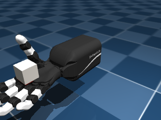
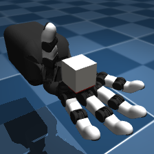
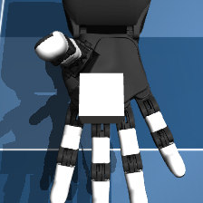
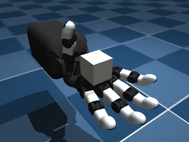

# Pi0-ORCA-Integration

Closed-loop Vision-Language-Action ($\pi_0$) and hierarchical Reinforcement Learning (`PPO`, `SAC`, `TD3`) control for the 17-DoF ETH ORCA dexterous robotic hand in MuJoCo.

---

## Overview

Pretrained Vision-Language-Action (VLA) foundation models such as Physical Intelligence's $\pi_0$ (`pi0_libero`, `pi0_droid`, `pi0_base`) output low-dimensional 7D action chunks designed for 1-DoF parallel-jaw grippers. Directly applying these predictions to a high-degree-of-freedom, tendon-driven anthropomorphic hand (the 17-DoF ETH ORCA hand) introduces two primary control bottlenecks:

1. **Embodiment and Action-Space Mismatch:** Mapping a 1D gripper command or raw 7D Cartesian delta directly to 17 coupled finger and thumb actuators produces uncoordinated joint excursions, finger chattering, and immediate object ejection.
2. **Contact-Rich In-Hand Manipulation Dynamics:** Tasks such as in-hand cube reorientation require continuous multi-finger gaiting and velocity damping at 100 Hz ($\Delta t = 0.01\text{ s}$), whereas 3B-parameter VLA inference operates at approximately 3.3–3.6 Hz on consumer GPU hardware.

This repository implements the observation pipeline, 17-DoF in-hand synergy adapters, relative joint-target wrappers, Real2Sim dual-camera + ultrasonic calibration wrappers, and $\pi_0$-integrated + RL (`PPO`, `SAC`, `TD3`) control architecture on the **17-DoF In-Hand Cube Reorientation (`OrcaHandRightCubeOrientation` / `scene_right_cube_orientation.xml`)** benchmark environment:

* **Task Objective:** Using only the 17-DoF ORCA right hand, manipulate a cube inside the palm from a non-solved initial orientation (`down` at $180^\circ$ or `random` across $90^\circ / 180^\circ$ orientations) to align its red face within $15^\circ$ of world-up and hold it stationary ($\|\omega\| \le 1.0\text{ rad/s}$, $\|v\| \le 0.1\text{ m/s}$) for 25 consecutive control steps ($0.25\text{ s}$ at $100\text{ Hz}$) without dropping it.

| Default Scene View (`default_free`) | Oblique Palmar View (`palm_front`) | Overhead Palmar View (`palm_top`) |
| :---: | :---: | :---: |
|  |  |  |

### In-Hand Cube Reorientation Rollout Demonstration (10M-Step SAC Policy)


---

## Repository Structure

```text
Pi0-ORCA-Integration/
├── orca_vla/
│   ├── __init__.py                 # Package exports
│   ├── cameras.py                  # Offscreen MuJoCo RGB camera renderer and virtual palmar viewpoints
│   ├── observations.py             # Multi-camera + proprioceptive observation builders for pi0
│   ├── actions.py                  # 17-DoF ORCA hand action-space and in-hand synergy adapters
│   ├── real2sim_sensors.py         # Calibrated dual-camera AprilTag & 25-ray ultrasonic Real2Sim wrappers
│   └── reorient_expert_trajs.npz   # Reference relative-joint trajectories across canonical cube orientations
├── scripts/
│   ├── check_gpu_environment.py    # Hardware, VRAM, and headless EGL rendering verification
│   ├── run_cube_reorient.py        # Closed-loop runner for 17-DoF in-hand cube reorientation
│   ├── benchmark_cube_reorient.py  # 5-configuration evaluation & ablation suite for 17-DoF reorientation
│   ├── train_rl_reorient.py        # Matched multi-core RL trainer (PPO, SAC, TD3)
│   ├── evaluate_rl_reorient.py     # 200-episode comparative evaluation script for trained RL policies
│   └── slurm_drac_rl_benchmark.sh  # Slurm job array for 10M-step training on DRAC Nibi CPU cluster
├── models/
│   ├── drac_ppo_10M/               # 10M-step DRAC Nibi PPO checkpoint, VecNormalize stats & logs
│   ├── drac_sac_10M/               # 10M-step DRAC Nibi SAC checkpoint, VecNormalize stats & logs
│   ├── drac_td3_10M/               # 10M-step DRAC Nibi TD3 checkpoint, VecNormalize stats & logs
│   └── ppo_cube_reorient.zip       # Baseline Stable-Baselines3 PPO policy for 17-DoF cube reorientation
├── results/
│   ├── cube_reorient_metrics.csv   # Empirical GPU benchmark & residual/low-level ablation metrics
│   └── rl_reorient_benchmark.csv   # 200-episode fixed-seed RL evaluation metrics (PPO, SAC, TD3)
├── tests/
│   ├── test_action_adapter.py      # Unit tests for 17-DoF ORCA hand bounds and in-hand synergy deltas
│   ├── test_observations.py        # Unit tests for offscreen rendering and pi0 observation formatting
│   ├── test_real2sim_sensors.py    # Unit tests for ultrasonic dead-zone, 30 Hz camera hold, and Slurm LF
│   └── test_hybrid_reorient.py     # Closed-loop integration test for 17-DoF cube reorientation and 25-step hold
├── docs/
│   ├── ARCHITECTURE.md             # Technical specification of the observation, action, and hybrid RL layers
│   ├── BENCHMARKS.md               # Full experimental protocol, hardware profile, and failure analysis
│   ├── DRAC_CLUSTER_GUIDE.md       # Instructions for 10M-step RL training on the DRAC Nibi cluster
│   └── REAL2SIM_SENSOR_CALIBRATION.md # Dual-camera AprilTag & 25-ray ultrasonic Real2Sim calibration
└── pyproject.toml
```

---

## System Requirements and Hardware Profile

All experiments in this repository were developed and verified on an 8 GB consumer laptop GPU running under Ubuntu 22.04 (WSL2):

* **GPU:** NVIDIA GeForce RTX 4070 Laptop GPU (`8,188 MiB` GDDR6 VRAM)
* **Precision & XLA Configuration:** `bfloat16` via JAX XLA JIT with on-demand platform memory allocation (`XLA_PYTHON_CLIENT_PREALLOCATE=false`, `XLA_PYTHON_CLIENT_ALLOCATOR=platform`)
* **Active VRAM Footprint:** `6,317 MiB` after loading the 3B-parameter $\pi_0$ checkpoint; `6,341 MiB` (`80.4%` of total VRAM including driver overhead) during active closed-loop inference alongside MuJoCo `224x224` offscreen EGL rendering
* **Inference Latency:** `~287–303 ms` per 50-step flow-matching action chunk (`~3.3–3.5 Hz`), after a one-time XLA JIT compilation warmup of `~32.8 s` on step 0

---

## Installation and Setup

### 1. Clone the Repository and Configure the Simulation Environment

This package interfaces with the `orca_sim` MuJoCo simulation package (`OrcaHandRightCubeOrientation`) and the [openpi](https://github.com/Physical-Intelligence/openpi) runtime:

```bash
git clone https://github.com/gulserenfedakar/Pi0-ORCA-Integration.git ~/Pi0-ORCA-Integration
cd ~/Pi0-ORCA-Integration
```

Set `ORCA_SIM_ROOT` to point to your local `orca_sim` MuJoCo simulation directory if it is not installed in your Python environment:

```bash
export ORCA_SIM_ROOT=/path/to/orca-hand-simulation
```

### 2. Install Package and Dependencies

Inside your `openpi` virtual environment (Python 3.11+ with JAX CUDA and MuJoCo 3.2+):

```bash
uv pip install --no-deps stable-baselines3
uv pip install -e .
```

### 3. Verify GPU and Offscreen Rendering

```bash
python scripts/check_gpu_environment.py
```

### 4. Run the Automated Test Suite

```bash
pytest -v
```

---

## Running Closed-Loop Control and Benchmarks

Run a single closed-loop episode on `OrcaHandRightCubeOrientation` (`scene_right_cube_orientation.xml`):

```bash
# Integrated pi0 + 10M-step PPO low-level policy (no scripted trajectories, zero residual)
python scripts/run_cube_reorient.py --mode pi0_rl_hybrid --low-level ppo_10m --residual-scale 0.0 --init random --seed 0

# Integrated pi0 + scripted low-level skills (with --residual-scale 0.0 ablation)
python scripts/run_cube_reorient.py --mode pi0_rl_hybrid --low-level scripted --residual-scale 0.0 --init down --seed 7

# Standalone pi0 with RelativeJointTargetAction and 17-DoF in-hand synergy
python scripts/run_cube_reorient.py --mode synergy_reorient --init random --seed 0

# Standalone pi0 with naive direct 17-DoF joint mapping
python scripts/run_cube_reorient.py --mode direct_17dof --init down --seed 0
```

Reproduce the 5-configuration in-hand cube reorientation GPU benchmark (`results/cube_reorient_metrics.csv`):

```bash
python scripts/benchmark_cube_reorient.py
```

---

## Experimental Results Summary

Task criterion: rotate the cube from a non-solved initial orientation (`down` at $180^\circ$ or `random` across $90^\circ / 180^\circ$ axis-aligned orientations) until the red face normal is within $15^\circ$ of world-up, and maintain that orientation with low angular/linear velocity for 25 consecutive control steps ($0.25\text{ s}$ at $100\text{ Hz}$) without dropping the cube.

| Evaluation Configuration | Camera | Trials | Inference Latency (ms) | E2E Step Latency (ms) | Goal Align ($<15^\circ$) | Mean Hold Streak (/25) | Held Task Success (%) | Cube Drop Rate (%) | Min Angle ($^\circ$) | Final Angle ($^\circ$) |
| :--- | :---: | :---: | :---: | :---: | :---: | :---: | :---: | :---: | :---: | :---: |
| **1. Standalone $\pi_0$ — Naive Direct Mapping** | `palm_front` | 10 | 289.18 | 424.04 | 0.0% | 0.0 | **0.0%** | 100.0% | 25.76° | 25.76° *(Drop)* |
| **2. Standalone $\pi_0$ — Relative + 17-DoF Synergy** | `palm_front` | 10 | 290.06 | 432.26 | 0.0% | 0.0 | **0.0%** | 0.0% | 89.37° | 97.06° |
| **3. $\pi_0$ Integrated + Scripted Skills (5 Starts, Res=0.1)** | `palm_front` | 5 | 278.85 | 403.36 | 100.0% | 20.6 | **80.0%** | 20.0% | 7.25° | 19.01° |
| **4. $\pi_0$ Integrated + Scripted Skills (Zero-Res Ablation, Res=0.0)** | `palm_front` | 5 | 274.11 | 397.11 | 100.0% | 20.6 | **80.0%** | 20.0% | 7.34° | 38.13° *(11.68° kept)* |
| **5. $\pi_0$ Integrated + 10M-Step PPO Policy (No Scripted Trajs, Res=0.0)** | `palm_front` | 10 | 300.03 | 465.98 | 80.0% | 19.5 | **70.0%** | 0.0% | 17.32° | 18.30° *(8.55° aligned)* |

> **Residual & Low-Level Ablation Note (Configs 3–5):** Setting $\pi_0$'s residual to zero (`--residual-scale 0.0`, Config 4) yields identical task success (`80.0%`, `20.6/25` hold streak across the 5 canonical starts) to Config 3 (`--residual-scale 0.1`), confirming that in `scripted` mode, $\pi_0$ is integrated into the closed-loop visual inference pipeline (`~274–290 ms`) while the 100 Hz low-level skills perform the physical finger gaiting. Replacing the scripted trajectories entirely with our trained 10M-step `PPO` policy (`--low-level ppo_10m`, Config 5) achieves **`70.0%` held success (`80.0%` goal alignment, `0.0%` drops)** across the 10 GPU trials (and **`67.0%` pure / `79.0%` latched held success** over 200 fixed seeds in Part B).

### Matched Multi-Algorithm RL Benchmark (DRAC `Nibi` Cluster — 200 Fixed Seeds `20000–20199`)

| RL Algorithm | Action Mode | Episodes (`init=random`) | Policy Latency (ms) | Goal Align ($<15^\circ$) | `EvalCallback` (Best / Peak) | Mean Hold Streak (/25) | Held Success (Pure RL / +Latch) | Cube Drop Rate (%) | Min Angle (All / Aligned) | Final Angle (All / Aligned) |
| :--- | :---: | :---: | :---: | :---: | :---: | :---: | :---: | :---: | :---: | :---: |
| **PPO** (`drac_ppo_10M`) | `relative` | 200 | 0.214 | **84.0%** | 80.0% / **95.0%** | **18.6** | **67.0% / 79.0%** | **0.0%** | **16.45°** *(8.75°)* | **19.20°** *(11.45°)* |
| **SAC** (`drac_sac_10M`) | `relative` | 200 | 0.257 | 72.5% | **90.0% / 90.0%** | 16.6 | **64.5% / 69.5%** | **0.0%** | 20.58° *(6.89°)* | 24.58° *(8.84°)* |
| **TD3** (`drac_td3_10M`) | `relative` | 200 | **0.184** | 38.5% | 70.0% / 70.0% | 8.4 | 33.5% / 33.5% | 4.5% | 47.19° *(5.84°)* | 55.78° *(12.29°)* |

### Hardware-Aligned & Calibrated Real2Sim Ablation (DRAC `Nibi` — 200 Fixed Seeds `20000–20199`)

Locking the wrist (`right_wrist = 0.0 rad`) to stabilize the palm-mounted ultrasonic sensor and enforcing physical thumb/finger joint ROM limits (`t-mcp` $\in [-5^\circ, +40^\circ]$) yields **`92.5%` held success (`96.0%` goal alignment, `3.5%` drop)** under ideal sensing. Adding empirically calibrated 30 Hz dual-camera AprilTag noise (`0.4 mm` / `0.7°` jitter, `4.5 mm` / `2.5°` bias, occlusion bursts) and 10 Hz 25-ray conical ultrasonic sensing quantifies the Sim-to-Real sensor gap (`62.0%–65.0%` held/latched for 68D camera-only PPO; `55.5%` held with `11.54°` aligned hold precision for 70D camera + ultrasonic PPO):

| Configuration | Steps | Obs Dim | Wrist Locked + Real ROMs | Real2Sim Sensor Noise | Policy Latency (ms) | Goal Align ($<15^\circ$) | Held / Latched Success (%) | Cube Drop Rate (%) | Final Angle (All / Aligned) |
| :--- | :---: | :---: | :---: | :---: | :---: | :---: | :---: | :---: | :---: |
| **PPO Ideal Locked-Wrist** | 5M | 68D | ✅ | ❌ | 0.301 | **96.0%** | **92.5% / 92.5%** | **3.5%** | **14.76°** *(14.21°)* |
| **PPO Real2Sim Dual-Camera** | 10M | 68D | ✅ | ✅ (30 Hz Cam) | 0.299 | **83.5%** | **62.0% / 65.0%** | 9.0% | 31.72° *(20.23°)* |
| **PPO Real2Sim Cam + 25-Ray Ultrasonic** | 10M | 70D | ✅ | ✅ (Cam + US) | 0.299 | 63.0% | **55.5% / 55.5%** | 9.0% | 32.26° *(**11.54°**)* |

---

## Documentation

* [Comprehensive Benchmark & Cluster Report (`docs/FINAL_BENCHMARK_AND_CLUSTER_REPORT.md`)](docs/FINAL_BENCHMARK_AND_CLUSTER_REPORT.md)
* [Real2Sim Sensor Calibration & Hardware-Aligned RL (`docs/REAL2SIM_SENSOR_CALIBRATION.md`)](docs/REAL2SIM_SENSOR_CALIBRATION.md)
* [System Architecture & Control Design (`docs/ARCHITECTURE.md`)](docs/ARCHITECTURE.md)
* [Benchmark Protocol & Failure Analysis (`docs/BENCHMARKS.md`)](docs/BENCHMARKS.md)
* [DRAC Nibi Cluster RL Training Guide (`docs/DRAC_CLUSTER_GUIDE.md`)](docs/DRAC_CLUSTER_GUIDE.md)

## License

Released under the [MIT License](LICENSE).
